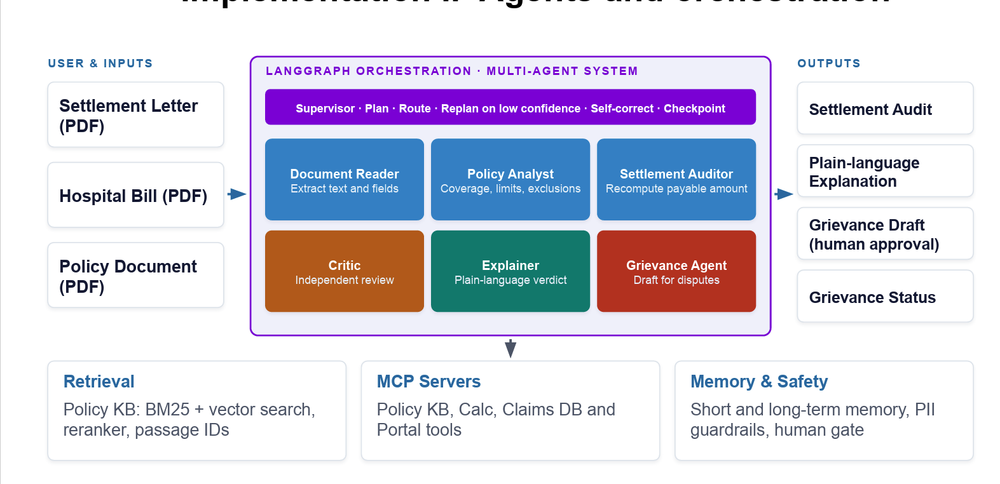
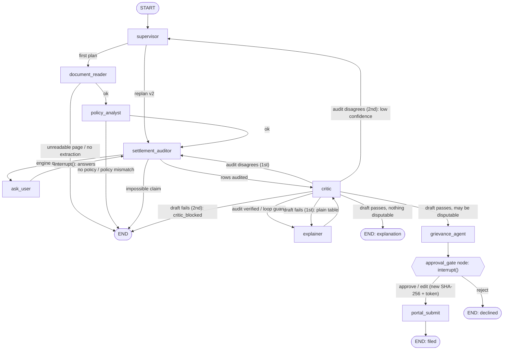

# ClaimClear architecture: agents and orchestration

This is the reference architecture (Implementation II, *Agents and orchestration*) and, for every box in it, the code that implements it in this repository.



---

## Contents

1. [The diagram, box by box](#1-the-diagram-box-by-box)
2. [The graph](#2-the-graph)
3. [State](#3-state)
4. [Routing and the critic loop](#4-routing-and-the-critic-loop)
5. [The approval gate](#5-the-approval-gate)
6. [Safety invariants and where they are enforced](#6-safety-invariants-and-where-they-are-enforced)
7. [Process layout](#7-process-layout)

---

## 1. The diagram, box by box

### User and inputs

| Box | Implemented by |
|---|---|
| Settlement Letter (PDF), Hospital Bill (PDF), Policy Document (PDF) | Uploaded by the app into **case-records** (`servers/case_records`, `CaseStore.create_case` / `add_document`) under neutral IDs (`case_…`, `doc_…`). The text is read by **document-reader** (`servers/document_reader`): PDF/JPG/PNG to text with source spans, Tesseract OCR for scans, hidden text and annotations kept apart as untrusted channels. An uploaded policy wording is indexed per case with `ClaimClearToolkit.ingest_uploaded_policy` (app only) |

### LangGraph orchestration: the multi-agent system (`agents/orchestration/claimclear_graph`)

| Box | Node / module | What it does | Tools it may call |
|---|---|---|---|
| **Supervisor**: Plan · Route · Replan on low confidence · Self-correct · Checkpoint | `agents/supervisor.py`, `plan.py`, `router.py`, `graph.py` | Builds the visible plan (contract `Plan`), loads the user's memory, replans (plan v2 with `replan_reason`) when the critic still disagrees after a retry. Routing is code (`router.py`), the critic loop self-corrects, and every step is checkpointed (`MemorySaver`, or a durable saver) | none |
| **Document Reader**: Extract text and fields | `agents/document_reader.py`, `extraction.py` | Reads every document; stops on an unreadable page (missing-document edge); collects guardrail flags; takes the claim and letter from the app, or extracts them with an LLM into the engine's own schemas (visible text only) | `list_case_documents`, `get_document_text` |
| **Policy Analyst**: Coverage, limits, exclusions | `agents/policy_analyst.py` | Policy schedule, which wording applies (asks for the user's own if needed), earlier claims merged with memory, candidate clauses for each letter row; replaces a look-alike policy number and flags it | `get_policy`, `get_policy_wording`, `get_claim_history`, `search_clauses` |
| **Settlement Auditor**: Recompute payable amount | `agents/settlement_auditor.py`, `ask_user` node | The policy-correct settlement; each letter row reproduced against every calculation method (which method did the insurer use, and does the policy allow it?). Pauses with `interrupt()` when the engine needs an answer (`Q-CONDITION-TYPE`, `Q-ROOM-PRICING`, …) and re-runs with it | `expected_settlement`, `reproduce_deduction` |
| **Critic**: Independent review | `agents/critic.py`, `checks.py` | Two reviews. **Audit:** re-runs the whole letter independently (`audit_settlement_letter`) and requires every row to agree. **Draft:** every ₹ figure from a tool, the allowed wording per verdict, no forbidden phrase, every cited clause real. Writes the contract `CriticReport` | `audit_settlement_letter` |
| **Explainer**: Plain-language verdict | `agents/explainer.py` | Sentences tied to facts, rows and clauses (contract `ExplainerDraft`) plus an audit table; second attempt is the plain verdict table | `clauses_for_rule` |
| **Grievance Agent**: Draft for disputes | `agents/grievance.py`, `approval_gate` / `portal_submit` nodes, `gateway.py` | Drafts a grievance for disputable rows only (contract `GrievanceDraft`, SHA-256 of the exact text); after the human gate, files it and reads back its status | `file_grievance`, `grievance_status` |

### Outputs

| Box | Where it is in the final state |
|---|---|
| Settlement Audit | `letter_audit` (policy payable, insurer paid, disputable, unverified), `row_audits` (verdict, method, difference per row), `audit_table_markdown` |
| Plain-language Explanation | `explanation` and `draft` (each sentence with its `fact_ids`, `row_ids`, `clause_ids`), passed by the critic (`critic.passed`) |
| Grievance Draft (human approval) | `grievance` (`text`, `text_sha256`, `row_ids`), waiting at `HumanApprovalGateway` |
| Grievance Status | `submission` (portal reference, `dry_run` until the mock portal exists), `grievance_status`, and the memory record's lifecycle (`draft → approved → filed → …`) |

### Bottom row

| Box | Implemented by |
|---|---|
| **Retrieval**: Policy KB, BM25 + vector search, reranker, passage IDs | `servers/policy_kb`: one chunk per clause, BM25 + vectors fused with RRF, query rewriting, optional reranker, stable clause IDs and citations, engine rule → clause maps (`rule_maps/`). Evaluated with Recall@k (`development/dev_eval/retrieval`) |
| **MCP Servers**: Policy KB, Calc, Claims DB and Portal tools | `servers/policy_kb` (8103), `servers/settlement_engine` (8101, "Calc"), `servers/case_records` (8102, "Claims DB"), `servers/insurer_portal` (8104, "Portal"), plus `servers/document_reader` (8105). Reached through `agents/toolkit` (`ClaimClearToolkit`: one session per server, stdio or HTTP) |
| **Memory & Safety**: short- and long-term memory, PII guardrails, human gate | **Short-term:** the graph state, checkpointed per thread (resume, inspect, time travel). **Long-term:** `memory/` (`claimclear_memory`): per-user policy profile, verified claims, sub-limit balances, grievance status; consent, expiry and "forget me". **Guardrails:** hidden-text channels and security flags from document-reader, look-alike policy numbers, tool arguments kept out of logs (`hooks.AuditLog`), personal names never stored. **Human gate:** `gateway.HumanApprovalGateway` + the portal's own hash and HMAC checks |

## 2. The graph



Built in `claimclear_graph/graph.py` (`build_claimclear_graph(services, checkpointer)`); every conditional edge is a function in `router.py`.

## 3. State

`GraphState` (`claimclear_graph/state.py`) **is** Member 2's contract `claimclear_contracts.CaseState`, so each field holds a server's own output shape and data flows from tool to tool without conversion, plus a few routing fields:

| Contract fields (from `contracts/claimclear_contracts/state.py`) | Added for orchestration |
|---|---|
| `case_id`, `user_id`, `plan`, `documents`, `claim`, `letter`, `sources`, `policy`, `wording`, `history`, `clauses`, `settlement`, `row_audits`, `letter_audit`, `questions`, `answers`, `memory`, `security_flags`, `critic`, `draft`, `grievance` | `page_summary` (instead of the contract's `pages`: document text is never checkpointed), `route`, `outcome`, `revision_count`, `max_revisions`, `replan_reason`, `replan_rows`, `critic_stage`, `critic_verdict`, `draft_attempt`, `explanation`, `audit_table_markdown`, `approval_token`, `human_approved`, `submission`, `grievance_status`, `memory_grievance_id`, `trace` (append-only) |

`outcome` says how a run ended: `grievance_filed`, `grievance_declined`, `no_grievance`, `needs_information`, `missing_document`, `ask_user_for_policy`, `policy_mismatch`, `invalid_extraction`, `extraction_needed`, `critic_blocked`, `tool_error`.

## 4. Routing and the critic loop

* Routes come from **tool results**, through `claimclear_tools.signals` (`after_settlement`, `rows_to_audit`, `after_row_audit`, `questions_to_ask`, `disputable_rows`, `after_letter_audit`), never from model text.
* Tool errors map to actions through `claimclear_tools.results.ERROR_ACTIONS`: `POLICY_NOT_FOUND` → ask the user for the policy, `INVALID_ARGUMENTS` → send back to the document reader, and so on.
* **Bounded reflection.** The 1st audit disagreement retries the auditor; the 2nd makes the supervisor replan; the 3rd (`max_revisions = 3`) stops the loop and the explainer works from the critic's own independent audit. A draft that fails is rewritten once as the plain verdict table; failing again ends the run (`critic_blocked`) so nothing unchecked reaches the user.
* With one deterministic engine the auditor and the critic agree on every real case (42/42 dev cases); the loop is the safety net for an LLM auditor, a stale extraction or a server change, and is tested by forcing a disagreement (`tests/test_graph_offline.py`).

## 5. The approval gate

1. `grievance_agent` always routes to the `approval_gate` node, which pauses with `interrupt()`. `portal_submit` can only be reached through the gate. With a durable checkpointer (`open_checkpointer`, `$CLAIMCLEAR_CHECKPOINTS`) the pause survives a restart.
2. `HumanApprovalGateway.get_pending_grievance()` shows the exact text and its SHA-256.
3. `approve_and_resume()` issues the approval token `HMAC-SHA256(CLAIMCLEAR_GATE_SECRET, text_sha256)`; the token is issued for the final text, and the gate node builds a new `GrievanceDraft` (new hash) for an edited text, so consent is bound to the text actually filed. `reject()` is recorded by the gate as its own step (`grievance_declined`), and nothing is filed.
4. `portal_submit` refuses without approval, without a token, or when the text no longer matches its hash, even if a bug routed to it without a decision (tested).
5. The insurer-portal server checks again: `TEXT_HASH_MISMATCH` for a changed text, `APPROVAL_REQUIRED` for a token not issued for that hash (with the secret set). Filing the same text twice returns the first reference.

## 6. Safety invariants and where they are enforced

| Invariant | Enforced in | Tested in |
|---|---|---|
| No LLM computes a rupee figure | the settlement engine computes; nodes only quote; the critic's figure check (`claimclear_tools.critic.unsupported_figures`) | `test_units.py::test_review_draft_flags_each_kind_of_failure`, every graph test |
| Each agent uses only its tools | `AGENT_TOOLS` + `services.ScopedToolkit` (deterministic nodes: typed calls, `call`, `tool`, `tools`, `for_agent`) + `hooks.permission_hook` (hook 1, `ToolNode`) | `test_scoped_toolkit_refuses_…`, `test_permission_hook_in_a_toolnode`, `test_hook1_on_real_mcp_tools` |
| Every MCP call observable | `hooks.AuditLog` (hook 2, toolkit interceptor; records server, tool, time, error from the message status; never arguments) | `test_audit_log_interceptor_…`, `test_set01_live_…` |
| Document text is data, not instructions | only visible text reaches extraction (`signals.visible_text`); hidden channels become `security_flags` | `test_llm_extractor_sends_visible_text_…` |
| Never guess from an unread page | `signals.after_document_text` → `missing_document` | `test_unreadable_page_takes_the_missing_document_edge` |
| Controlled wording, no promises | `verdicts.VERDICT_WORDING`, `FORBIDDEN_PHRASES`, checked by the critic | `test_draft_failing_twice_is_blocked_…` |
| Nothing filed without a person's approval of the exact text | gate + `portal_submit` + portal server | 6 offline gate tests, 2 live |
| Untrusted document text is not kept at rest | the state holds only `page_summary` | `test_document_text_is_not_checkpointed_only_a_summary` |
| A transient outage doesn't end a case | `ScopedToolkit` retries retryable errors with bounded back-off | `test_retryable_error_is_retried_…`, `test_non_retryable_error_is_not_retried_…` |
| Paused cases survive restarts | `checkpoints.open_checkpointer` (SQLite / PostgreSQL) | `test_paused_case_survives_a_restart_with_sqlite` |
| Rewritten or translated text is still checked | the critic reviews what the user reads | `test_rewriter_that_changes_a_figure_is_caught_…` |
| Memory only with consent; no names; amounts copied from the engine | `claimclear_memory` (`session_memory` → `NoMemory` without consent) | `test_memory_…` (offline and live) |

## 7. Process layout

```
 app (Member 4) ──► claimclear_graph (LangGraph, .venv-agents) ──► claimclear_tools.ClaimClearToolkit
                         │  checkpointer (thread per case)              │ one MCP session per server
                         │  claimclear_memory (SQLite / PostgreSQL)     ▼  (stdio child processes, or HTTP)
                         │                                   ┌──────────────┬──────────────┬───────────┬────────────────┐
                         │                                   │ settlement-  │ case-records │ policy-kb │ insurer-portal │
                         │                                   │ engine :8101 │ :8102        │ :8103     │ :8104          │
                         │                                   └──────────────┴──────┬───────┴───────────┴────────────────┘
                         │                                                         ▼
                         │                                              document-reader :8105 (OCR)
                         ▼
                 HumanApprovalGateway ◄── the policyholder (approve / edit / reject, answer questions)
```

The servers run in `.venv` (mcp 2.3), the agents in `.venv-agents` (langchain-mcp-adapters, mcp 1.x): separate processes by design.
