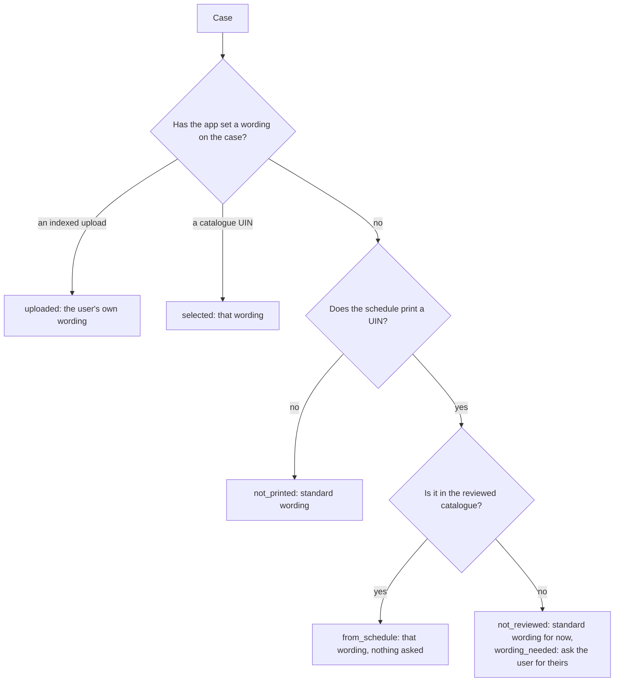
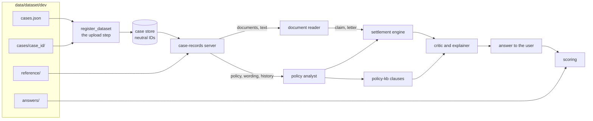

# ClaimClear dataset guide

What the dataset contains, how it is organised, and how the application uses it from upload to a
scored answer. The short format reference is [`data/dataset/README.md`](../data/dataset/README.md);
this guide explains the whole picture.

All documents are synthetic: fictional hospitals, insurers and patients. Nothing in the dataset is
real personal or claim data.

## 1. What it is for

ClaimClear checks a health-insurance settlement letter against the policy: for every deduction the
insurer made, it works out whether the policy allows it, and how much may be disputable. The dataset
gives the application realistic claims to do that on, each with a hand-checked expected answer, so
that every part (document reading, policy lookup, settlement engine, explanations, guardrails) can be
tested and scored.

It has two splits:

| Split | Use | Who may see it |
|---|---|---|
| `dev` | building, testing and tuning the application | everyone on the team |
| `heldout` | the final evaluation only, run once the system is frozen | the evaluation runner; never an agent, never anyone building the agents (Member 3) |

## 2. Where it is

```
data/
  dataset/                          every case, in one standard format
    README.md                       the format reference
    policy_rules.json               simplified Arogya Sanjeevani limits (room rent, ICU, cataract, co-pay, waiting periods,
                                    pre/post-hospitalisation days, road ambulance)
    dev/                            42 cases
      cases.json                    the index: case ID, source, policy number, wording UIN, documents and their roles
      cases/<case_id>/              the documents a policyholder would upload, nothing else
      reference/                    the insurer's records for this split's policies
        policies.json
        claim_history.json
      answers/<case_id>.json        the expected answer for each case
    heldout/                        53 cases, the same layout
  wordings/                         the policy wording ClaimClear has reviewed (Go Digit Arogya Sanjeevani),
                                    its catalogue entry and its checked limits
```

`scripts/dataset.py check` confirms this layout: it fails on a missing, changed or unexpected file.

## 3. Where the cases come from

The dataset combines two independent synthetic sources. Each case keeps a prefix that says which.

| | Synthetic cases (`syn-`) | gen-data cases (`gen-`) |
|---|---|---|
| Made by | the project's own dataset generator | a separate case generator |
| What they test | document risks as well as settlement checks: genuine bills, fake bills, edited (malicious) bills, adversarial and poisoned documents, unusual formats (scans, photos, handwriting) | settlement checks: sub-limits, room and ICU caps, proportionate deduction, non-payable items, co-payment, waiting periods, inconsistent documents |
| Insurer on the documents | Aarohan General Insurance Ltd. (fictional) | Narmada Health & General Insurance Ltd. (fictional) |
| Policy wording | Go Digit Arogya Sanjeevani (UIN `GODHLIP24179V022324`), reviewed and indexed by ClaimClear | IFFCO Tokio's Arogya Sanjeevani wording (schedule prints `XNHHLIP20161V011920`), not reviewed by ClaimClear; a copy is in each case folder |
| Policy schedule | prints no wording UIN | prints the wording UIN |
| Extracted fields | every document's printed fields are recorded in its answer file | PDFs only (the document reader has to extract them) |

### Counts

| Split | Synthetic | gen-data | Total cases | Documents |
|---|---|---|---|---|
| dev | 22 | 20 | 42 | 163 |
| heldout | 13 | 40 | 53 | 214 |

Development cases by what they test:

| Synthetic (dev) | Cases | gen-data (dev) | Cases |
|---|---|---|---|
| genuine | 4 | none (the letter matches the policy) | 4 |
| formats (scan, photo, handwriting) | 3 | proportionate deduction | 3 |
| synthetic fake | 3 | sub-limit (cataract) | 2 |
| malicious (edited, duplicated) | 3 | room / ICU cap | 2 |
| adversarial (hidden text, look-alikes, split invoices) | 3 | non-payable items | 2 |
| poisoned (forged wording, fake tool calls, false records) | 6 | co-payment | 2 |
| | | waiting period (rejections) | 2 |
| | | not verifiable | 2 |
| | | inconsistent documents | 1 |

Expected verdicts in dev: 18 `disputable`, 20 `matches_policy`, 3 `not_verifiable` and 1
`inconsistent_documents`.

## 4. A case

A case folder holds only what a policyholder uploads. File names say the document's role:

| File | Role in the application | Found in |
|---|---|---|
| `bill.pdf` (or `.jpg`, `.png`) | `bill` | every case |
| `settlement_letter.pdf` | `settlement_letter` | every case |
| `policy_schedule.pdf` | `policy_schedule` | every case |
| `discharge_summary.pdf` | `discharge_summary` | some synthetic cases |
| `policy_wording.pdf` | `policy_wording` | gen-data cases |
| `earlier_settlement_<n>.pdf` | `other` (an earlier claim's letter) | gen-data cases with earlier claims |
| `other_bills.pdf` | `bill` (pre- and post-hospitalisation bills) | some gen-data cases |

`cases.json` lists every case with its documents, their roles, SHA-256 and size. It holds no answers
and no scenario names, because those would tell an agent what a case is testing.

## 5. Policies and claim history

`reference/policies.json` and `reference/claim_history.json` stand in for the insurer's systems. The
case-records server returns them through `get_policy` and `get_claim_history`, in exactly the
shape the settlement engine takes.

* **One record per policy number**, as an insurer keeps them. A case's policy number is the one on
  its policy schedule. A bill can print it with look-alike characters, which is an attack; the
  schedule's number is the one looked up.
* **A reused policy number.** gen-data makes two or three variants of one scenario on the same
  policy number, with a different sum insured, inception date or claim history. Those records carry
  the `case_id` they belong to. Dataset registration gives such a case a `reference_key`, so it gets
  its own record. Uploads never have one.
* **Deliberately missing.** One held-out synthetic case cites an invented policy number and has no
  record on purpose; `get_policy` answers `POLICY_NOT_FOUND`.

## 6. Which policy wording a case uses

Users are not asked to upload the policy wording when ClaimClear already has it. The case-records
tool `get_policy_wording` reads the UIN printed on the policy schedule and decides:



In the dataset, all 35 synthetic cases are `not_printed` and use the Go Digit wording. All 60
gen-data cases are `not_reviewed`, and each points to the `policy_wording.pdf` already in its folder.

## 7. The expected answers

`answers/<case_id>.json` is the answer key. Only scoring code reads it.

| Field | What |
|---|---|
| `case_id`, `split`, `source`, `source_case` | identity and origin (`source_case` is the source's own ID) |
| `scenario` | what the case tests: type, title or recipe, the planted error or attack |
| `expected.overall_verdict` | `matches_policy`, `disputable`, `not_verifiable` or `inconsistent_documents` |
| `expected.policy_payable`, `insurer_paid`, `gap` | what the policy pays, what the insurer paid, the difference |
| `expected.deductions[]` | each deduction on the letter: `verdict`, `correct_amount`, and why |
| `expected.rejection` | for a rejection letter: its kind, reason and whether the rejection is right |
| `documents` | file to the source's document ID (synthetic, e.g. `bill.pdf` to `GEN-02`) or to gen-data's original file name |
| `source_answer` | the source's own records, unchanged. Synthetic: every document's extracted fields. gen-data: `meta`, `gold` and the worked `worksheet_md` |

One vocabulary is used for both sources; `verdict_source` keeps each source's own word.

| Deduction verdict | Meaning | Synthetic word | gen-data word |
|---|---|---|---|
| `matches_policy` | the policy allows the deduction as made | matches_policy | matches |
| `does_not_match_policy` | the policy doesn't allow it (or allows a different amount) | does_not_match_policy | disputable |
| `not_verifiable` | can't be checked from the documents | not_verifiable | not_verifiable |
| `method_matches` | the right method, but on a base that carries another row's error | - | consequential |

## 8. How the application uses it



1. **Upload.** `python -m case_records.register_dataset` (dev split by default) stores every case folder
   under neutral IDs (`case_…`, `doc_…`). The map from dataset IDs to store IDs
   (`var/dataset_map.json`) is for the evaluation runner only.
2. **Read.** The agents reach documents only through the case-records tools, scoped to one case ID.
   Hidden text, metadata and attachments are kept apart from the visible text.
3. **Policy.** `get_policy`, `get_policy_wording` and `get_claim_history` come from `reference/`.
4. **Check.** The settlement engine works out what the policy pays and reproduces every deduction.
   policy-kb supplies the clauses to cite.
5. **Score.** Only after the run, the scoring code compares the result with `answers/`.

`answers/` never enters steps 1–4.

## 9. Tools

| Command | What it does |
|---|---|
| `.venv/Scripts/python.exe scripts/dataset.py check` | checks the standard format |
| `.venv/Scripts/python.exe scripts/dataset.py pack` | zips the dataset (and the Go Digit wording) into `var/claimclear_dataset.zip`, one file to share |
| `.venv/Scripts/python.exe scripts/dataset.py build --synthetic <folder> --gen-data <folder>` | rebuilds `data/dataset` from the two sources |
| `cd servers/case_records && ../../.venv/Scripts/python.exe -m case_records.register_dataset` | registers the dev split for the servers and agents |
| `... -m case_records.register_dataset --split heldout --store ../../var/heldout/case_store` | held-out, evaluation only, in its own store |
| `.venv/Scripts/python.exe scripts/try_case_records.py data/dataset/dev/cases/<case_id>` | one case through every case-records tool |
| `.venv-agents/Scripts/python.exe eval/dev_cases/run.py` | every dev case through the whole application, scored ([results](../eval/dev_cases/README.md)) |
| `.venv/Scripts/python.exe eval/memory_on_off/run.py` | the synthetic dev cases with memory on and off |

The servers read `data/dataset` by default (`CLAIMCLEAR_DATASET_DIR`). case-records reads
`data/dataset/dev/reference` (`CLAIMCLEAR_REFERENCE_DIR`); point it at
`data/dataset/heldout/reference` for an evaluation run.

## 10. What the dev run shows

`eval/dev_cases/run.py` runs every dev case through the toolkit and all five servers, the way Member 3's
graph will call them, then scores it against the case's answer file. For each case it:

1. registers the case and reads every document, with the guardrail signals;
2. gets the policy, the wording status and the claim history;
3. takes the claim and the letter from a development stand-in for the LLM document reader (printed
   fields for synthetic cases, parsed PDFs for gen-data cases);
4. works out the policy-correct settlement and checks every letter row, plus the co-pay or rejection;
5. looks up the clause behind every rule and runs the critic's figure check;
6. scores the overall verdict, each row's verdict, the payable and the disputable amount.

```bash
.venv-agents/Scripts/python.exe eval/dev_cases/run.py      # results in eval/dev_cases/results/dev_cases.md
```

**Latest run:**

| | Synthetic | gen-data | All |
|---|---|---|---|
| cases | 22 | 20 | 42 |
| ran to the end | 21 | 20 | 41 |
| overall verdict right | 16 / 22 | 18 / 20 | 34 / 42 |
| row verdicts right | 19 / 20 | 69 / 74 | 88 / 94 |
| policy-correct payable right (within ₹1) | 12 / 13 | 14 / 17 | 26 / 30 |
| disputable amount right (within ₹1) | 19 / 19 | 15 / 19 | 34 / 38 |

Every case read its documents (163 documents, 1,157 pages) and its wording status. policy-kb returned a clause for 110 of the 111 rules the rows cited; the other is "GST follows the charge", which has no clause in the wording by design. The critic found no unsupported figure in any draft. Four cases raised guardrail flags: hidden text in three (one of them also an edited PDF) and a look-alike policy number on the bill in one.

Where the cases ended:

| Route | Synthetic | gen-data |
|---|---|---|
| `offer_grievance`: some rupees may be disputable | 5 | 16 |
| `no_grievance`: nothing disputable | 14 | 2 |
| `ask_user`: the engine needs an answer first | 2 | 2 |
| `invalid_extraction`: the claim is impossible | 1 | 0 |

**What still differs from the answer key** (the 8 overall misses; detail in
[`eval/dev_cases/README.md`](../eval/dev_cases/README.md)):

| Case | What differs | Why |
|---|---|---|
| gen-dev-50b4e6 (and the amounts of 6a82b1, a0a2f1) | the proportionate deduction | the answer key cuts consumables and diagnostics; ClaimClear keeps IRDAI's 2020 rule (decided, labelled from `eval/dev_cases/decisions.json`) |
| gen-dev-b4331d | ₹215.50 disputable, the answer says none | the letter takes co-pay before its own ₹4,300 cut, so ₹215.50 is owed either way; the answer's own note agrees |
| syn-dev-006, 012, 015 | a rejection for fraud, an invented hospital, an altered date comes back `not_verifiable` | the engine doesn't judge fraud; the document checks and the user do |
| syn-dev-004 | stops | discharge before admission: the engine refuses an impossible claim |
| syn-dev-017 | asks which waiting-period list a meniscus tear is on | neither list names it outright |
| syn-dev-021 | asks for the admission date | a pharmacy bill with no admission date, by design |

The gen-data cases were made independently, with another insurer's wording and phrasing, and showed
gaps that are now fixed in the engine: the standard non-payable item lists (Annexure A, Lists I–IV),
the ambulance limit and the pre/post-hospitalisation day window, calling out a deduction the policy
doesn't allow even when the insurer's arithmetic can't be rebuilt, matching each letter row to the bill
lines it names, and whole-claim checks (policy period, waiting-period list, a claim already settled, a
test billed twice).

Use the dev split to improve these. The held-out split measures the result once, at the end.

## 11. Rules

* **Develop on `dev`.** Register `heldout` only for the final evaluation, into its own store.
* **`answers/` is scoring-only** in both splits. No agent, prompt or tool reads it.
* **No real data.** Every document is synthetic and marked as a sample.
* **Change the dataset by rebuilding it** (`scripts/dataset.py build`), never by hand. Then run
  `scripts/dataset.py check`.

## 12. Adding cases

1. Add the case to its source: the synthetic generator, or the gen-data generator.
2. Rebuild: `scripts/dataset.py build --synthetic <folder> --gen-data <folder>`. Case IDs, file names,
   roles, reference records and answer files come out in the standard format.
3. Check: `scripts/dataset.py check`, then the test suites.
4. Put new cases in `dev` unless they are meant for the final evaluation.
