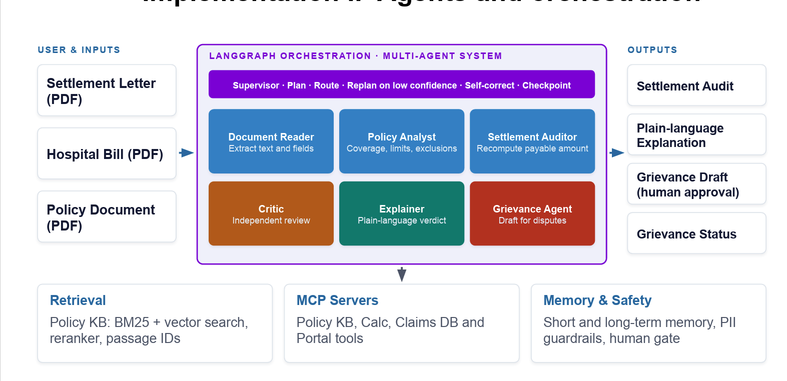
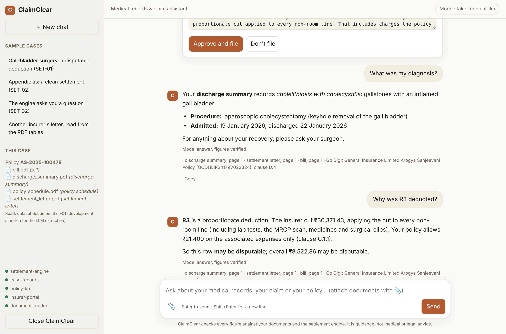
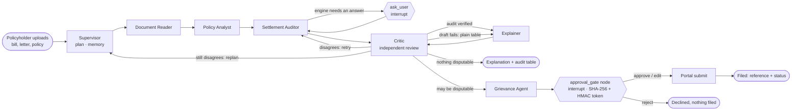

# ClaimClear Development

**A post-settlement assistant for health-insurance policyholders.** Upload the hospital bill, the insurer's settlement letter and the policy; ClaimClear checks every deduction against the policy wording, explains the result in plain language with the clause behind each line, and — only when something may be disputable and only after you approve the exact text — drafts and files a grievance.

> **The rule behind every line:** the model proposes, code decides. No LLM computes or checks a rupee figure; document text is data, never instructions; every tool is reached through a `case_id`; a person approves anything that changes the outside world.

This repository combines two code bases into one working system:

| Part | Owner | Folder | What it is |
|---|---|---|---|
| Knowledge, memory and tools | Member 2 | `servers/`, `contracts/`, `memory/`, `agents/toolkit/`, `dev_data/`, `dev_eval/dev_cases/` | Five MCP servers (settlement engine, case records, policy KB, insurer portal, document reader), the shared contracts, long-term memory and the agents' toolkit |
| Agents and orchestration | Member 3 | `agents/orchestration/`, `dev_eval/graph_dev_cases/` | The LangGraph multi-agent graph: supervisor, six specialists, critic loop with replanning, memory, and the human approval gate |

The architecture below is the reference for both; [docs/member3_orchestration/architecture.md](docs/member3_orchestration/architecture.md) maps every box to the code that implements it.



---

## Contents

1. [How a case flows](#1-how-a-case-flows)
2. [Repository layout](#2-repository-layout)
3. [Two Python environments](#two-python-environments)
4. [Run it](#4-run-it)
5. [Tests](#5-tests)
6. [Results on the development cases](#6-results-on-the-development-cases)
7. [Configuration](#7-configuration)
8. [Documents](#8-documents)

---

## Quick start: one command

| System | Command (from the `ClaimClear` folder) |
|---|---|
| Windows (CMD) | `start.bat` |
| macOS / Linux | `./start.sh` |
| Any | `python start.py` |
| Local LLM first (optional) | `start_llm.bat` / `./start_llm.sh`: start a model on this computer and choose which; ClaimClear then uses it by default |

It starts with **any Python 3.8 or newer, including 3.15**. The libraries ClaimClear depends on are published for Python 3.12–3.14 only, so the launcher builds the environments with one of those: your Python if it is one of them, otherwise another one it finds on the machine, otherwise a private copy of Python 3.13 that it downloads into the project's `.python` folder (nothing is installed system-wide). The first run takes a few minutes: it creates both Python environments, installs everything, tries to install Tesseract OCR, loads the development cases and builds the policy index. Later runs skip all that and start in a few seconds. It then starts the five MCP servers in the background.

It then opens **ClaimClear in your browser**: a chat assistant, much like Claude's chat window, for your hospital records and your claim.

* **Attach documents** with the 📎 button or by dropping them on the page: the hospital bill, discharge summary, settlement letter and policy schedule. Or click a sample case.
* **Watch the agents work live** in a collapsible "Checking your claim…" block. Then you get what was found (insurer paid, policy allows, may be disputable, row by row with policy clauses), any question the engine needs answered, and a grievance letter you can edit, approve or decline.
* **Ask anything** about your medical records, the settlement or the policy: "What was my diagnosis?", "Why was R3 deducted?", "Is cataract surgery covered?". Answers stream in as they are written and remember the conversation. Every rupee amount is checked as it streams: if a model writes an amount that isn't in your documents, the audit or the policy, the answer is withdrawn and replaced by a checked one.
* **Everything keeps running in the background until you close the page** (or press *Close ClaimClear*, or Ctrl+C in the terminal). Then the web UI and the five servers stop by themselves. Reloading the page keeps your session.



**Choosing the model.** Two kinds of model are supported: a **local LLM** on this computer, or **OpenRouter**.

**A local LLM is chosen by default.** At every start, `start.py` checks whether one is running: Ollama (port 11434), LM Studio (port 1234) or a llama.cpp server (port 8080). If it finds one, the chat and the document reader use it, so your medical records never leave this computer. The start-up window says which model it picked. Otherwise OpenRouter is used if a key is saved, or no model at all. `--no-local-llm` turns this off for one run.

**Starting a local LLM, with a choice of model.** Run the second launcher:

```bash
start_llm.bat                      # Windows
./start_llm.sh                     # macOS / Linux
```

It finds Ollama, or offers to install it (with `winget` on Windows or `brew` on a Mac; elsewhere it gives the download link). It then starts Ollama in the background and shows a numbered menu: the models you already have, then recommended ones to download:

| Model | Good for | Download |
|---|---|---|
| `llama3.1:8b` | a good all-rounder (about 8 GB of RAM) | 4.9 GB |
| `qwen2.5:7b` | tables and figures (about 8 GB of RAM) | 4.7 GB |
| `mistral:7b` | fast, plain English (about 8 GB of RAM) | 4.1 GB |
| `gemma2:9b` | careful answers, a little slower (about 10 GB of RAM) | 5.4 GB |
| `llama3.2:3b` | older computers (about 4 GB of RAM) | 2.0 GB |

Type a number, or any model name from ollama.com/library. It downloads the model if needed, loads it into memory and saves the choice in `.env`. Then start ClaimClear as usual. Other options:

| Option | What it does |
|---|---|
| `--model qwen2.5:7b` | Use this model without asking (downloaded if needed) |
| `--list` | Show installed and recommended models; change nothing |
| `--start` | Start ClaimClear afterwards (other options are passed on, e.g. `--start --no-browser`) |

If LM Studio or a llama.cpp server is already running and Ollama isn't installed, the menu shows the models loaded there instead.

**Changing the model in the page.** Click the model name at the top right of the page (**⚙ No model configured · set up** when there is none), choose **Local model**, **OpenRouter** (paste your key from openrouter.ai; model names look like `openai/gpt-4.1-mini`) or **No model**, then press **Save and test**. ClaimClear sends the model a one-word test message, and only if it answers does it save the choice and switch to it, with no restart. The key is kept only on this computer, in the `.env` file next to `start.py`, and is never shown again. Choosing OpenRouter or No model here is remembered: later starts no longer switch to a local LLM by themselves (they do again once you run `start_llm` or choose Local model).

| Choice | What you need | Where your records go |
|---|---|---|
| **Local model** (default when running) | `start_llm.bat` / `./start_llm.sh`, or any running Ollama / LM Studio / llama.cpp | **Never leave this computer** |
| **OpenRouter** | An API key from openrouter.ai → Keys | Sent to OpenRouter and the model you chose |
| **No model** | Nothing | Nowhere: answers come from your records, the audit and the policy (rows, amounts, clauses, diagnosis, dates, bill items), but not free-form questions |

If the test fails, the dialog says why (for example *Is the local model running?* or *too little credit*), and nothing is saved. The test asks for a one-word reply, and every answer has a length limit (`CLAIMCLEAR_MAX_TOKENS`, default 1,500 tokens), so a key with a small credit limit works. You can also write the settings into `.env` by hand; see `.env.example`.

**Your data is not kept.** Uploaded documents, chats and dry-run filings exist only while ClaimClear runs. They are deleted when you close the page, and at the next start if ClaimClear was stopped abruptly. A new launch never shows a previous conversation. **🗑 Clear my data** in the sidebar deletes everything at once. To keep data between runs, start with `--keep-data`. The sample cases are synthetic test data that ships with the project.

| Option | What it does |
|---|---|
| `--console` | The terminal console instead of the web page |
| `--no-browser` | Doesn't open the browser; open the printed address yourself |
| `--keep-data` | Keeps uploaded documents, chats and filings after closing (default: deleted) |
| `--no-local-llm` | Doesn't switch to a running local LLM for this run (uses the saved setting) |
| `--set-openrouter-key` | Paste your OpenRouter key at a hidden prompt (or pipe it in); it is checked with OpenRouter (no cost), your credit is shown, and it is saved to `.env`. Nothing is saved if OpenRouter refuses it |
| `--check-openrouter` | Is the saved key accepted, free tier or paid, and how much credit is left |
| `--memory-user ID` | Long-term memory for this local user: verified claims, grievances and the topics of earlier conversations (amounts never kept), recalled in later chats. Used only after `python -m claimclear_memory consent ID` |
| `--auto SET-01` | Runs one case with no prompts, approves, and exits: a self-check |
| `--servers-only` | Just keeps the five servers running (Ctrl+C stops them) |
| `--reinstall` | Rebuilds both environments |
| `--download-python` | Always builds the environments with the private downloaded Python 3.13 |

## 1. How a case flows



Each specialist calls **only its own tools** on the MCP servers (`claimclear_tools.agents.AGENT_TOOLS`), and every rupee figure comes from the settlement engine:

| Agent | MCP tools | Server |
|---|---|---|
| Document Reader | `list_case_documents`, `get_document_text` | case-records (reads through document-reader: PDF/OCR, hidden text kept apart) |
| Policy Analyst | `get_policy`, `get_policy_wording`, `get_claim_history`, `search_clauses` | case-records, policy-kb |
| Settlement Auditor | `expected_settlement`, `reproduce_deduction` | settlement-engine |
| Critic | `audit_settlement_letter` (+ figure / wording / clause checks) | settlement-engine |
| Explainer | `clauses_for_rule` | policy-kb |
| Grievance Agent | `file_grievance`, `grievance_status` (only after approval) | insurer-portal |

On SET-01 (the handover's worked example) the run reproduces the insurer's error on row R3 (a proportionate cut applied to every non-room line: ₹30,371.43 instead of the policy's ₹21,400), finds **₹8,522.86 may be disputable**, explains every row with its clause, drafts a grievance for R3 only, pauses for approval, and files it (dry run) with the approved text's SHA-256.

## 2. Repository layout

```
ClaimClear/
├── start.bat / start.sh / start.py              one command: install, start the servers, open the web UI
├── start_llm.bat / start_llm.sh / start_llm.py  start a local LLM and choose its model
├── agents/
│   ├── orchestration/          Member 3: claimclear_graph — the LangGraph multi-agent system
│   │   ├── claimclear_graph/   agents/ (one module per agent), state, services, router, checks, plan, gateway,
│   │   │                       hooks, extraction, language, checkpoints, graph
│   │   ├── examples/           console.py (terminal console, --auto self-check), record_fixtures.py
│   │   └── tests/              offline (recorded real tool outputs) + live against the servers
│   └── toolkit/                Member 2: claimclear_tools — one client for every MCP server
├── servers/                    Member 2: the five MCP servers (ports 8101–8105)
│   ├── settlement_engine/      every rupee: expected settlement, 41 calculation methods, matcher
│   ├── case_records/           a case's documents, policy schedule, claim history
│   ├── policy_kb/              clause search: BM25 + vectors + RRF, reranker, clause IDs, rule maps
│   ├── insurer_portal/         file_grievance (gated write) and grievance_status, dry-run backend
│   └── document_reader/        PDF/JPG/PNG to text with spans, Tesseract OCR, hidden-text channels
├── contracts/                  CaseState, hand-offs (Plan, CriticReport, ExplainerDraft, GrievanceDraft), tool schemas
├── memory/                     claimclear_memory: per-user policy profile, claims, balances, grievance status
├── dev_data/                       42 dev cases with answers, the Arogya Sanjeevani wording, policy rules
├── dev_eval/
│   ├── dev_cases/              C0 fixed workflow over every dev case (Member 2)
│   ├── graph_dev_cases/        the same cases through the multi-agent graph (Member 3)
│   └── memory_on_off/          memory on vs off
├── scripts/                    dev_servers.py (all five over HTTP), dataset tools
├── deploy/                     PostgreSQL + pgvector + MinIO for the production backends
└── docs/                       all documentation: setup/, member2_knowledge_memory_tools/, member3_orchestration/, shared/
```

## Two Python environments

`langchain-mcp-adapters` needs `mcp` 1.x while the servers use `mcp` 2.3, so the servers and the agents never share an environment; the agents start (stdio) or connect to (HTTP) the servers as separate processes.

| Environment | For | Install (macOS / Linux; on Windows use `Scripts\python.exe`) |
|---|---|---|
| `.venv` | the five servers, memory, contracts and their tests | `python -m venv .venv` then `.venv/bin/python -m pip install -r requirements-servers.txt` and `-e` each of `servers/*`, `contracts`, `memory` |
| `.venv-agents` | the toolkit and the multi-agent graph | `python -m venv .venv-agents` then `.venv-agents/bin/python -m pip install -r requirements-agents.txt` |

Python 3.12 or newer for both. **Tesseract OCR** reads scans and photos (`sudo apt-get install tesseract-ocr tesseract-ocr-eng`, `brew install tesseract`, or `winget install UB-Mannheim.TesseractOCR`); without it a scanned page is reported unreadable and the graph asks for a better copy instead of guessing.

## 4. Run it

From the repository root, after installing both environments:

```bash
python start.py --auto SET-01
```

A self-check without prompts: the servers start, SET-01 runs through every agent, the grievance is approved and filed (dry run), and everything stops. `--auto SET-02` is a clean settlement, `--auto SET-22` meets an engine question (a pharmacy receipt's admission dates; the self-check skips it). SET-32 no longer asks: the insurer paid that claim, so the engine audits it on the insurer's own acceptance. Without `--auto`, `python start.py` opens the web UI.

```bash
.venv-agents/bin/python dev_eval/graph_dev_cases/run.py
```

All 42 development cases through the graph, scored against their answers and compared with the C0 run.

```bash
.venv/bin/python scripts/dev_servers.py
```

The five servers over HTTP on ports 8101–8105; then set `CLAIMCLEAR_MCP_MODE=http` for the agents (or pass `--http` to the eval runs).

Using the graph from the app:

```python
from claimclear_tools import ClaimClearToolkit
from claimclear_memory import MemoryStore
from claimclear_graph import Services, build_claimclear_graph, initial_state, HumanApprovalGateway

async with ClaimClearToolkit() as tk:                                  # keep it open while graphs run
    graph = build_claimclear_graph(Services(toolkit=tk, memory_store=MemoryStore()))
    cfg = {"configurable": {"thread_id": case_id}}
    state = await graph.ainvoke(initial_state(case_id, user_id=user_id, claim=claim, letter=letter), cfg)
    gate = HumanApprovalGateway(graph)
    if questions := await gate.pending_questions(cfg):                # e.g. Q-CONDITION-TYPE
        state = await gate.answer_questions(cfg, {"Q-CONDITION-TYPE": "illness"})
    if await gate.is_paused_for_approval(cfg):                         # show state["grievance"]["text"]
        state = await gate.approve_and_resume(cfg)                     # or edited_text=..., or gate.reject(cfg)
    print(state["outcome"], state["explanation"])
```

`claim` and `letter` are the settlement engine's `ClaimIn` / `LetterIn`; pass `Services(extractor=llm_extractor(chat_model))` (`claimclear_graph.extraction`) to have the document reader extract them from the uploaded documents instead.

## 5. Tests

| Suite | Command (from its folder) | Result here (Linux, Python 3.12/3.13, Tesseract 5.3) |
|---|---|---|
| multi-agent graph, every agent, the web UI | `cd agents/orchestration && ../../.venv-agents/bin/python -m pytest --cov=claimclear_graph --cov-branch` | **479 passed, 1 skipped (PostgreSQL)**, 96 % line+branch coverage, random order; see [docs/member3_orchestration/testing.md](docs/member3_orchestration/testing.md) |
| agents' toolkit | `cd agents/toolkit && ../../.venv-agents/bin/python -m pytest` | 45 passed (live against the servers) |
| policy-kb | `cd servers/policy_kb && ../../.venv/bin/python -m pytest` | 110 passed, 5 skipped |
| insurer-portal | `cd servers/insurer_portal && ../../.venv/bin/python -m pytest` | 13 passed |
| memory | `cd memory && ../.venv/bin/python -m pytest` | 49 passed, 42 skipped (PostgreSQL not running) |
| contracts | `cd contracts && ../.venv/bin/python -m pytest` | 22 passed; `python -m claimclear_contracts.export --check` up to date |
| eval helpers | `cd dev_eval/dev_cases` / `dev_eval/memory_on_off` | 3 + 3 passed |
| settlement-engine | `cd servers/settlement_engine && ../../.venv/bin/python -m pytest` | 315 passed, 6 skipped ¹ |
| document-reader | `cd servers/document_reader && ../../.venv/bin/python -m pytest` | 69 passed, 11 skipped ¹ |
| case-records | `cd servers/case_records && ../../.venv/bin/python -m pytest` | 25 passed, 34 skipped ¹ |

¹ The skipped tests read the **held-out split** (`dev_data/dataset/heldout/`, documents such as SET-06, FMT-04, POI-08), which is not part of this upload; each suite's `conftest.py` lists them and skips them with that reason while the folder is missing (three case-records skips need PostgreSQL). Restore `dev_data/dataset/heldout` and they run as in Member 2's CI. `pytest` hides the summary line (`addopts = -q`); add `-o addopts=""` to see the counts. CI (`.github/workflows/ci.yml`) runs every suite on each push.

## 6. Results on the development cases

| Run | Cases | Ran to the end (audit produced) | Overall verdict right | Row verdicts right | Payable right (±₹1) | Disputable right (±₹1) |
|---|---|---|---|---|---|---|
| C0 fixed workflow (`dev_eval/dev_cases`) | 42 | 42 | 40/42 | 89/94 | 28/31 | 37/40 |
| Multi-agent graph (`dev_eval/graph_dev_cases`) | 42 | 42 | 40/42 | 89/94 | 28/31 | 37/40 |

Every case reaches a defined outcome and produces an audit. The graph agrees with the fixed workflow on every case's overall verdict (42/42): orchestration adds the plan, the critic's independent re-check and draft review, the questions, the explanation and the approval gate without changing a single figure. The two misses: gen-dev-50b4e6, where the answer key differs by a documented decision (IRDAI's 2020 proportionate-deduction rule, `dev_eval/dev_cases/decisions.json`), and syn-dev-021, a pharmacy bill with no admission date, where the engine asks for the date rather than assume it. 19 cases stopped at the approval gate; none was filed without approval. Details: [`dev_eval/graph_dev_cases/results/graph_dev_cases.md`](dev_eval/graph_dev_cases/results/graph_dev_cases.md).

## 7. Configuration

Environment variables, with safe defaults under `var/` (git-ignored). Secrets go in `.env` only (see `.env.example`).

| Variable | Default | Meaning |
|---|---|---|
| `CLAIMCLEAR_MCP_MODE` | `stdio` | Agents start the servers as child processes (`stdio`) or connect to running ones (`http`) |
| `CLAIMCLEAR_SERVER_PYTHON` | `<repo>/.venv` | The Python the agents start the servers with |
| `CLAIMCLEAR_CHECKPOINTS` | unset (in memory) | Where paused cases are kept: `sqlite:///var/graph/checkpoints.db` or `postgresql://...`, so a case waiting at a question or the gate survives a restart (`claimclear_graph.open_checkpointer`) |
| `CLAIMCLEAR_LLM_BASE_URL`, `CLAIMCLEAR_LOCAL_MODEL` | unset | The local LLM (written by `start_llm`); used first |
| `OPENROUTER_API_KEY`, `CLAIMCLEAR_CHAT_MODEL` | unset, `openai/gpt-4.1-mini` | OpenRouter, used when no local LLM is set |
| `CLAIMCLEAR_AUTO_LOCAL` | unset | `0`: `start.py` doesn't switch to a running local LLM by itself (written when you choose OpenRouter in the page) |
| `CLAIMCLEAR_EXTRACTION_MODEL` | the chat model | Model override for `dev_eval/graph_dev_cases/run.py --llm-extract` |
| `CLAIMCLEAR_EXTRACTION_MAX_TOKENS` | `4000` | The document reader's extraction reply limit (at least 500). Lower it for a key with little credit: OpenRouter reserves the whole limit and refuses with HTTP 402 when it can't afford it |
| `CLAIMCLEAR_MAX_TOKENS` | `1500` | The longest reply the chat model may write. Always sent to the provider, so keys with a small credit limit work; the settings test uses 16, document extraction 4,000 |
| `CLAIMCLEAR_MEMORY_USER` | unset | The local user whose long-term memory the web UI uses (with consent); unset = memory off. See [docs/member2_knowledge_memory_tools/memory.md](docs/member2_knowledge_memory_tools/memory.md#episodic-memory-earlier-conversations) |
| `CLAIMCLEAR_GATE_SECRET` | unset | Approval-gate HMAC secret. Set it for **both** the gateway and the insurer-portal server: the portal then accepts only `HMAC-SHA256(secret, text_sha256)` tokens. Unset, the portal checks only that a token is present (development) |
| `CLAIMCLEAR_CASE_STORE`, `CLAIMCLEAR_REFERENCE_DIR` | `var/case_store`, `dev_data/dataset/dev/reference` | Case store and reference data |
| `CLAIMCLEAR_POLICY_KB_INDEX` | `var/policy_kb/index.json` | Policy index (build it: `python -m policy_kb build --wording ...`) |
| `CLAIMCLEAR_MEMORY_DB` | `var/memory/memory.db` | SQLite file or `postgresql://...` |
| `CLAIMCLEAR_PORTAL_STORE` | `var/insurer_portal/dry_run.json` | The dry-run portal's record of filings |
| `CLAIMCLEAR_*_URL` | `http://127.0.0.1:810x/mcp` | Server URLs in HTTP mode |

Every server-side variable is listed in [docs/member2_knowledge_memory_tools/overview.md](docs/member2_knowledge_memory_tools/overview.md#6-configuration).

## 8. Documents

All documentation is in [`docs/`](docs/README.md), one document per topic, grouped by who needs it:

| Folder | For |
|---|---|
| [`docs/setup/`](docs/setup/setup_guide.md) | Running ClaimClear. **Start with [setup_guide.md](docs/setup/setup_guide.md)** |
| [`docs/member2_knowledge_memory_tools/`](docs/member2_knowledge_memory_tools/overview.md) | The MCP servers, retrieval, memory, contracts, toolkit, the dataset and its case book |
| [`docs/member3_orchestration/`](docs/member3_orchestration/architecture.md) | The multi-agent graph, the web UI, the tests |
| [`docs/shared/`](docs/shared/code_walkthrough.md) | The code walkthrough, the integration notes, the architecture diagram |

The [docs index](docs/README.md) lists every document and what to read it for.
