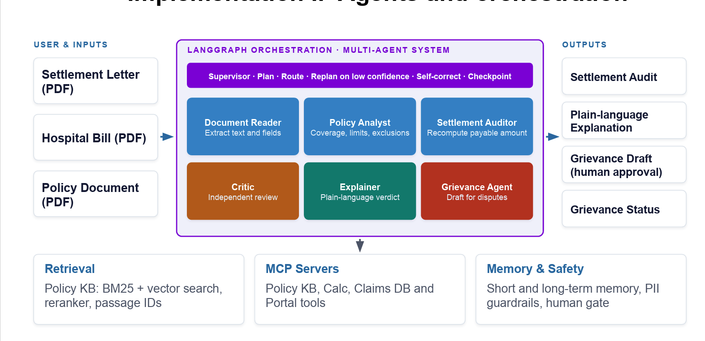
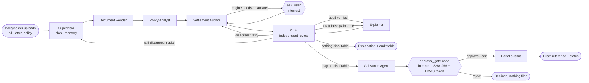

# ClaimClear

**A post-settlement assistant for health-insurance policyholders.** Upload the hospital bill, the insurer's settlement letter and the policy; ClaimClear checks every deduction against the policy wording, explains the result in plain language with the clause behind each line, and — only when something may be disputable and only after you approve the exact text — drafts and files a grievance.

> **The rule behind every line:** the model proposes, code decides. No LLM computes or checks a rupee figure; document text is data, never instructions; every tool is reached through a `case_id`; a person approves anything that changes the outside world.

This repository combines two code bases into one working system:

| Part | Owner | Folder | What it is |
|---|---|---|---|
| Knowledge, memory and tools | Member 2 | `servers/`, `contracts/`, `memory/`, `agents/toolkit/`, `data/`, `eval/dev_cases/` | Five MCP servers (settlement engine, case records, policy KB, insurer portal, document reader), the shared contracts, long-term memory and the agents' toolkit |
| Agents and orchestration | Member 3 | `agents/orchestration/`, `eval/graph_dev_cases/` | The LangGraph multi-agent graph: supervisor, six specialists, critic loop with replanning, memory, and the human approval gate |

The architecture below is the reference for both; [docs/architecture.md](../Code/docs/architecture.md) maps every box to the code that implements it.



---

## Contents

1. [How a case flows](#1-how-a-case-flows)
2. [Repository layout](#2-repository-layout)
3. [Two Python environments](#two-python-environments)
4. [Run it](#4-run-it)
5. [Tests](#5-tests)
6. [Results on the development cases](#6-results-on-the-development-cases)
7. [Configuration](#7-configuration)
8. [Documents](#8-documents)

---

## 1. How a case flows



Each specialist calls **only its own tools** on the MCP servers (`claimclear_tools.agents.AGENT_TOOLS`), and every rupee figure comes from the settlement engine:

| Agent | MCP tools | Server |
|---|---|---|
| Document Reader | `list_case_documents`, `get_document_text` | case-records (reads through document-reader: PDF/OCR, hidden text kept apart) |
| Policy Analyst | `get_policy`, `get_policy_wording`, `get_claim_history`, `search_clauses` | case-records, policy-kb |
| Settlement Auditor | `expected_settlement`, `reproduce_deduction` | settlement-engine |
| Critic | `audit_settlement_letter` (+ figure / wording / clause checks) | settlement-engine |
| Explainer | `clauses_for_rule` | policy-kb |
| Grievance Agent | `file_grievance`, `grievance_status` (only after approval) | insurer-portal |

On SET-01 (the handover's worked example) the run reproduces the insurer's error on row R3 (a proportionate cut applied to every non-room line: ₹30,371.43 instead of the policy's ₹21,400), finds **₹8,522.86 may be disputable**, explains every row with its clause, drafts a grievance for R3 only, pauses for approval, and files it (dry run) with the approved text's SHA-256.

## 2. Repository layout

```
ClaimClear/
├── agents/
│   ├── orchestration/          Member 3: claimclear_graph — the LangGraph multi-agent system
│   │   ├── claimclear_graph/   agents/ (one module per agent), state, services, router, checks, plan, gateway,
│   │   │                       hooks, extraction, language, checkpoints, graph
│   │   ├── examples/           demo.py (live or --offline), record_fixtures.py
│   │   └── tests/              offline (recorded real tool outputs) + live against the servers
│   └── toolkit/                Member 2: claimclear_tools — one client for every MCP server
├── servers/                    Member 2: the five MCP servers (ports 8101–8105)
│   ├── settlement_engine/      every rupee: expected settlement, 41 calculation methods, matcher
│   ├── case_records/           a case's documents, policy schedule, claim history
│   ├── policy_kb/              clause search: BM25 + vectors + RRF, reranker, clause IDs, rule maps
│   ├── insurer_portal/         file_grievance (gated write) and grievance_status, dry-run backend
│   └── document_reader/        PDF/JPG/PNG to text with spans, Tesseract OCR, hidden-text channels
├── contracts/                  CaseState, hand-offs (Plan, CriticReport, ExplainerDraft, GrievanceDraft), tool schemas
├── memory/                     claimclear_memory: per-user policy profile, claims, balances, grievance status
├── data/                       42 dev cases with answers, the Arogya Sanjeevani wording, policy rules
├── eval/
│   ├── dev_cases/              C0 fixed workflow over every dev case (Member 2)
│   ├── graph_dev_cases/        the same cases through the multi-agent graph (Member 3)
│   └── memory_on_off/          memory on vs off
├── scripts/                    dev_servers.py (all five over HTTP), dataset tools
├── deploy/                     PostgreSQL + pgvector + MinIO for the production backends
└── docs/                       architecture, integration notes, handover, dataset guide, memory policy
```

## Two Python environments

`langchain-mcp-adapters` needs `mcp` 1.x while the servers use `mcp` 2.3, so the servers and the agents never share an environment; the agents start (stdio) or connect to (HTTP) the servers as separate processes.

| Environment | For | Install (macOS / Linux; on Windows use `Scripts\python.exe`) |
|---|---|---|
| `.venv` | the five servers, memory, contracts and their tests | `python -m venv .venv` then `.venv/bin/python -m pip install -r requirements-servers.txt` and `-e` each of `servers/*`, `contracts`, `memory` |
| `.venv-agents` | the toolkit and the multi-agent graph | `python -m venv .venv-agents` then `.venv-agents/bin/python -m pip install -r requirements-agents.txt` |

Python 3.12 or newer for both. **Tesseract OCR** reads scans and photos (`sudo apt-get install tesseract-ocr tesseract-ocr-eng`, `brew install tesseract`, or `winget install UB-Mannheim.TesseractOCR`); without it a scanned page is reported unreadable and the graph asks for a better copy instead of guessing.

## 4. Run it

From the repository root, after installing both environments:

```bash
.venv-agents/bin/python agents/orchestration/examples/demo.py --offline
```

The whole graph on SET-01 from recorded server outputs: plan, trace, explanation, grievance, approval, filing. No servers needed.

```bash
.venv-agents/bin/python agents/orchestration/examples/demo.py
```

The same against the live servers (started over stdio). `--case SET-02` is a clean settlement, `--case SET-32` pauses for a question, `--decision edit|reject` exercises the gate.

```bash
.venv-agents/bin/python eval/graph_dev_cases/run.py
```

All 42 development cases through the graph, scored against their answers and compared with the C0 run.

```bash
.venv/bin/python scripts/dev_servers.py
```

The five servers over HTTP on ports 8101–8105; then set `CLAIMCLEAR_MCP_MODE=http` for the agents (or pass `--http` to the eval runs).

Using the graph from the app:

```python
from claimclear_tools import ClaimClearToolkit
from claimclear_memory import MemoryStore
from claimclear_graph import Services, build_claimclear_graph, initial_state, HumanApprovalGateway

async with ClaimClearToolkit() as tk:                                  # keep it open while graphs run
    graph = build_claimclear_graph(Services(toolkit=tk, memory_store=MemoryStore()))
    cfg = {"configurable": {"thread_id": case_id}}
    state = await graph.ainvoke(initial_state(case_id, user_id=user_id, claim=claim, letter=letter), cfg)
    gate = HumanApprovalGateway(graph)
    if questions := await gate.pending_questions(cfg):                # e.g. Q-CONDITION-TYPE
        state = await gate.answer_questions(cfg, {"Q-CONDITION-TYPE": "illness"})
    if await gate.is_paused_for_approval(cfg):                         # show state["grievance"]["text"]
        state = await gate.approve_and_resume(cfg)                     # or edited_text=..., or gate.reject(cfg)
    print(state["outcome"], state["explanation"])
```

`claim` and `letter` are the settlement engine's `ClaimIn` / `LetterIn`; pass `Services(extractor=llm_extractor(chat_model))` (`claimclear_graph.extraction`) to have the document reader extract them from the uploaded documents instead.

## 5. Tests

| Suite | Command (from its folder) | Result here (Linux, Python 3.12/3.13, Tesseract 5.3) |
|---|---|---|
| multi-agent graph | `cd agents/orchestration && ../../.venv-agents/bin/python -m pytest` | **62 passed** (54 offline on recorded real tool outputs, 8 live against the servers) |
| agents' toolkit | `cd agents/toolkit && ../../.venv-agents/bin/python -m pytest` | 45 passed (live against the servers) |
| policy-kb | `cd servers/policy_kb && ../../.venv/bin/python -m pytest` | 110 passed, 5 skipped |
| insurer-portal | `cd servers/insurer_portal && ../../.venv/bin/python -m pytest` | 13 passed |
| memory | `cd memory && ../.venv/bin/python -m pytest` | 49 passed, 42 skipped (PostgreSQL not running) |
| contracts | `cd contracts && ../.venv/bin/python -m pytest` | 22 passed; `python -m claimclear_contracts.export --check` up to date |
| eval helpers | `cd eval/dev_cases` / `eval/memory_on_off` | 3 + 3 passed |
| settlement-engine | `cd servers/settlement_engine && ../../.venv/bin/python -m pytest` | 315 passed, 6 skipped ¹ |
| document-reader | `cd servers/document_reader && ../../.venv/bin/python -m pytest` | 69 passed, 11 skipped ¹ |
| case-records | `cd servers/case_records && ../../.venv/bin/python -m pytest` | 25 passed, 34 skipped ¹ |

¹ The skipped tests read the **held-out split** (`data/dataset/heldout/`, documents such as SET-06, FMT-04, POI-08), which is not part of this upload; each suite's `conftest.py` lists them and skips them with that reason while the folder is missing (three case-records skips need PostgreSQL). Restore `data/dataset/heldout` and they run as in Member 2's CI. `pytest` hides the summary line (`addopts = -q`); add `-o addopts=""` to see the counts. CI (`.github/workflows/ci.yml`) runs every suite on each push.

## 6. Results on the development cases

| Run | Cases | Ran to the end (audit produced) | Overall verdict right | Row verdicts right | Payable right (±₹1) | Disputable right (±₹1) |
|---|---|---|---|---|---|---|
| C0 fixed workflow (`eval/dev_cases`) | 42 | 41 | 34/42 | 88/94 | 26/30 | 34/38 |
| Multi-agent graph (`eval/graph_dev_cases`) | 42 | 41 | 34/42 | 88/94 | 26/30 | 34/38 |

Every case reaches a defined outcome (the one without an audit, syn-dev-004, is an impossible extraction sent back to the document reader). The graph agrees with the fixed workflow on every case's overall verdict (42/42): orchestration adds the plan, the critic's independent re-check and draft review, the questions, the explanation and the approval gate without changing a single figure. The eight misses are the engine's and the answer keys' (three are documented decisions in `eval/dev_cases/decisions.json`). 19 cases stopped at the approval gate; none was filed without approval. Details: [`eval/graph_dev_cases/results/graph_dev_cases.md`](../Code/eval/graph_dev_cases/results/graph_dev_cases.md).

## 7. Configuration

Environment variables, with safe defaults under `var/` (git-ignored). Secrets go in `.env` only (see `.env.example`).

| Variable | Default | Meaning |
|---|---|---|
| `CLAIMCLEAR_MCP_MODE` | `stdio` | Agents start the servers as child processes (`stdio`) or connect to running ones (`http`) |
| `CLAIMCLEAR_SERVER_PYTHON` | `<repo>/.venv` | The Python the agents start the servers with |
| `CLAIMCLEAR_CHECKPOINTS` | unset (in memory) | Where paused cases are kept: `sqlite:///var/graph/checkpoints.db` or `postgresql://...`, so a case waiting at a question or the gate survives a restart (`claimclear_graph.open_checkpointer`) |
| `OPENROUTER_API_KEY` / `OPENAI_API_KEY`, `CLAIMCLEAR_EXTRACTION_MODEL` | unset, `openai/gpt-4.1-mini` | Only for LLM extraction (`eval/graph_dev_cases/run.py --llm-extract`) and the plain-language / translation rewriter |
| `CLAIMCLEAR_GATE_SECRET` | unset | Approval-gate HMAC secret. Set it for **both** the gateway and the insurer-portal server: the portal then accepts only `HMAC-SHA256(secret, text_sha256)` tokens. Unset, the portal checks only that a token is present (development) |
| `CLAIMCLEAR_CASE_STORE`, `CLAIMCLEAR_REFERENCE_DIR` | `var/case_store`, `data/dataset/dev/reference` | Case store and reference data |
| `CLAIMCLEAR_POLICY_KB_INDEX` | `var/policy_kb/index.json` | Policy index (build it: `python -m policy_kb build --wording ...`) |
| `CLAIMCLEAR_MEMORY_DB` | `var/memory/memory.db` | SQLite file or `postgresql://...` |
| `CLAIMCLEAR_PORTAL_STORE` | `var/insurer_portal/dry_run.json` | The dry-run portal's record of filings |
| `CLAIMCLEAR_*_URL` | `http://127.0.0.1:810x/mcp` | Server URLs in HTTP mode |

Every server-side variable is listed in [docs/member2_overview.md](../Code/docs/member2_overview.md#6-configuration).

## 8. Documents

| Document | What it covers |
|---|---|
| [docs/GUIDE_1_SETUP.md](../Code/docs/GUIDE_1_SETUP.md) ([Word](../Code/docs/guides/GUIDE_1_SETUP.docx), [PDF](../Code/docs/guides/GUIDE_1_SETUP.pdf)) | **Start here.** Step by step from the zip to a running system, tests and evaluation, with troubleshooting |
| [docs/GUIDE_2_CODE_WALKTHROUGH.md](../Code/docs/GUIDE_2_CODE_WALKTHROUGH.md) ([Word](../Code/docs/guides/GUIDE_2_CODE_WALKTHROUGH.docx), [PDF](../Code/docs/guides/GUIDE_2_CODE_WALKTHROUGH.pdf)) | Code review of every part, then a simple (SET-02) and a complex (SET-01) case traced node by node |
| [docs/architecture.md](../Code/docs/architecture.md) | The reference architecture, box by box, mapped to code; the graph, its state, the safety invariants |
| [docs/integration_notes.md](../Code/docs/integration_notes.md) | How the two code bases were merged: what was kept, replaced or removed, every behaviour change, and why |
| [agents/orchestration/orchestration_README.md](../Code/agents/orchestration/orchestration_README.md) | The multi-agent graph: nodes, routes, gateway, hooks, extending it with an LLM |
| [agents/toolkit/toolkit_README.md](../Code/agents/toolkit/toolkit_README.md) | The client for every MCP server: per-agent tools, signals, critic checks |
| [servers/servers_README.md](../Code/servers/servers_README.md) | How the agents connect to the servers; each server's own README for its tools and errors |
| [docs/member2_overview.md](../Code/docs/member2_overview.md) | Member 2's full guide: components, step-by-step runs, configuration, production backends |
| [docs/member2_technical_handover.md](../Code/docs/member2_technical_handover.md) | Every tool with real inputs and outputs, hook points, memory, storage |
| [docs/dataset_guide.md](../Code/docs/dataset_guide.md), [docs/memory_policy.md](../Code/docs/memory_policy.md) | The cases and answers; what memory keeps and for how long |
