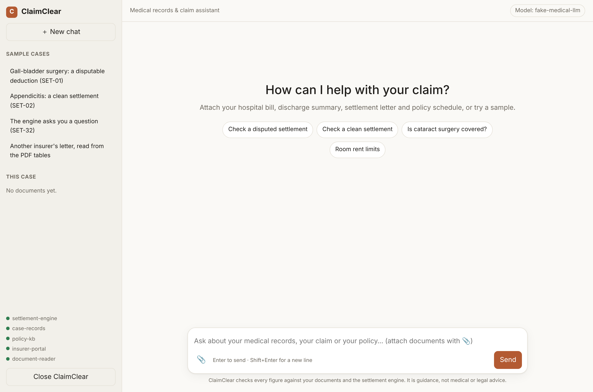
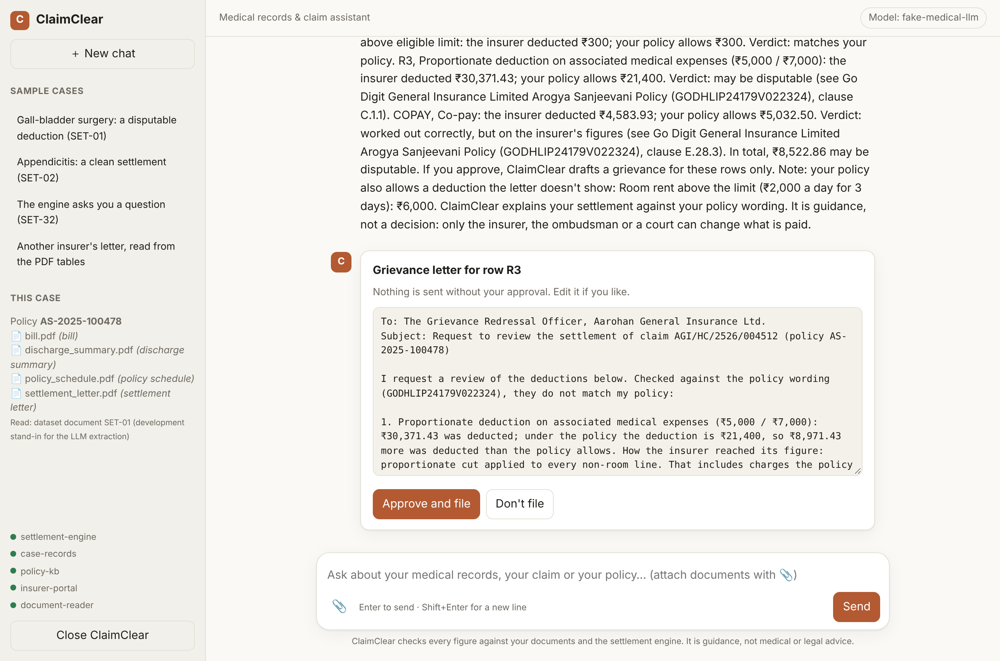
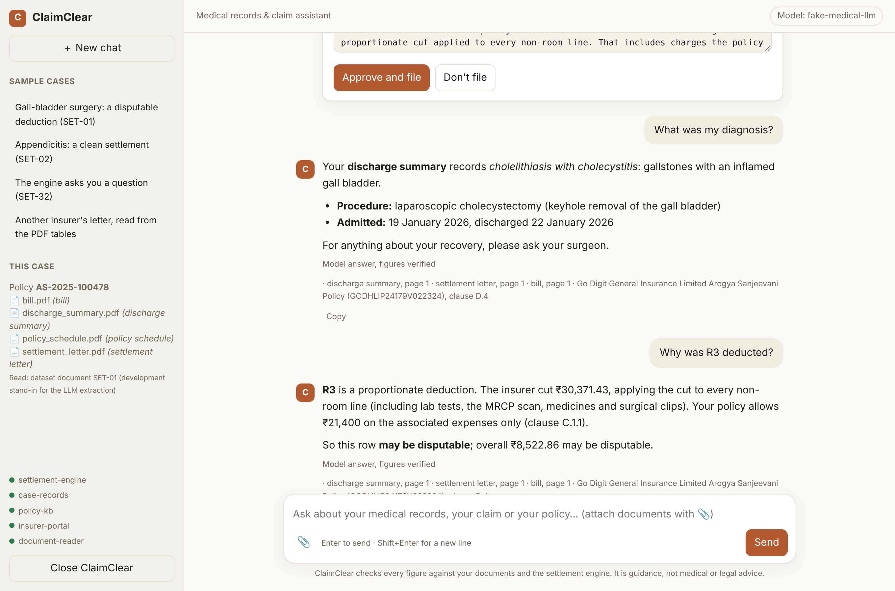
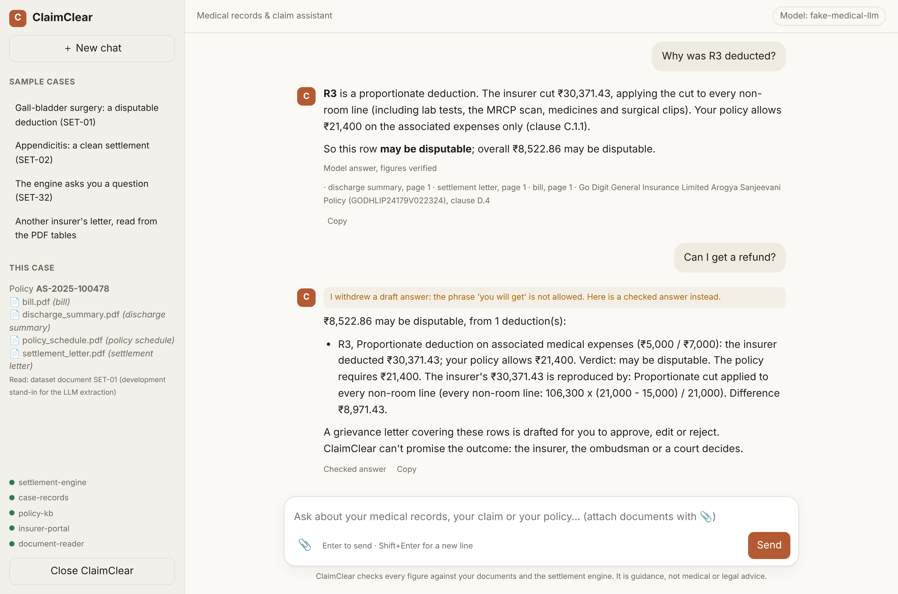
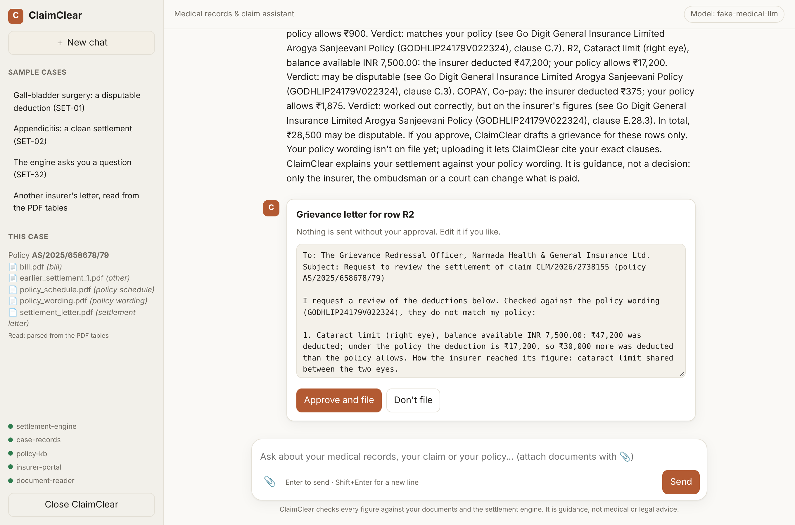
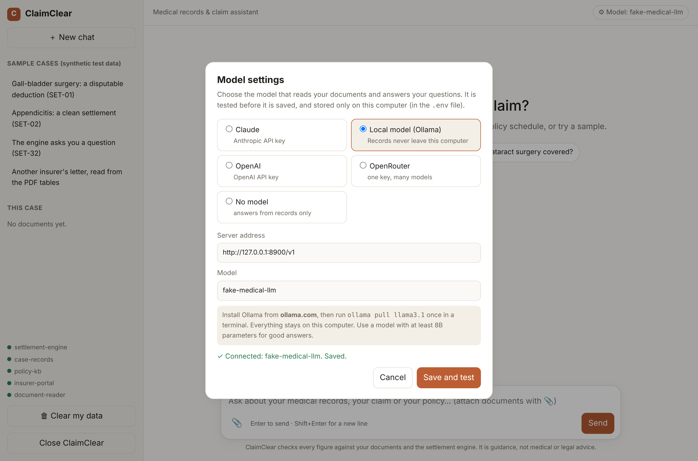

# ClaimClear_GenAI
<a id="top"></a>

### ClaimClear: By-Team5
#### Empowering Policyholders
### <i>A post-settlement assistant for health-insurance policyholders </i>

<br> 


<br>

<details open>

  <summary style="color: red;">Table of Contents</summary>
<li> <a href="#a1">Introduction</a></li>
<li> <a href="#a2"> Prerequisites and Techstack</a></li>
<li> <a href="#a3"> Steps for Execution </a></li>
<li>  <a href="#a5">Screenshots</a></li>
<li>  <a href="#a4">Usage</a></li>
<a href="#end"><u><i>Skip to END...</i></u></a>
</details>
</br>

<a id="a1"></a>

## Introduction :-

<br>

### About ClaimClear:

##### Domain-> Health Insurance
##### Who uses it-> Policyholder


<br>

##### * ClaimClear is a post-settlement assistant.
##### * It is mainly designed for health-insurance policyholders who may or maynot understand insurance domain terms.
##### * In critical situations of health policyholders or their relatives may not be able to cross verify the settlement or what other documents or bills are needed from their end.
##### * Moreover, policyholders usually maynot have the time and patience to go through a long document or pdf, of say 40 pages, while trying to figure out due to which points or situations are these deductions applicable or not.

<br>

You upload the hospital bill, the insurer's settlement letter and the policy. ClaimClear checks every deduction against the policy wording, explains the result in plain language with the clause behind each line, and only when something may be disputable, and only after you approve the exact text, drafts and files a grievance.

> **The rule behind every line:** the model proposes, code decides. No LLM computes or checks a rupee figure; document text is data, never instructions; every tool is reached through a `case_id`; a person approves anything that changes the outside world.

<br>

### Repo Structure:

<br>

```
ClaimClear_GenAI/
├── README.md                       this page
└── ClaimClear/                     the application
    ├── start.bat / start.sh / start.py   one command: install, start the servers, open the web UI
    ├── start_llm.bat / .sh / .py         start a local LLM and choose its model
    ├── agents/
    │   ├── orchestration/          the LangGraph multi-agent system (supervisor, six specialists, critic loop, approval gate, web UI)
    │   └── toolkit/                one client for every MCP server
    ├── servers/                    the five MCP servers (ports 8101-8105)
    │   ├── settlement_engine/      every rupee: expected settlement, 51 calculation methods, matcher, integrity checks
    │   ├── case_records/           a case's documents, policy schedule, claim history
    │   ├── policy_kb/              clause search: BM25 + vectors + RRF, clause IDs, rule maps
    │   ├── insurer_portal/         file_grievance (gated write) and grievance_status, dry-run backend
    │   └── document_reader/        PDF/JPG/PNG to text with spans, Tesseract OCR, hidden-text channels
    ├── contracts/                  shared state, hand-offs, tool schemas
    ├── memory/                     long-term and episodic memory (with consent)
    ├── dev_data/                   42 dev cases with answers, the Arogya Sanjeevani wording, policy rules
    ├── dev_eval/                   dev cases (fixed workflow), the same cases through the graph, memory on/off, retrieval
    ├── scripts/ and deploy/        helper scripts; PostgreSQL + pgvector + MinIO for production backends
    ├── Golden_Dataset/             the golden dataset (info.txt: Dev 20, Eval 40, RedTeam 30 = 90 cases)
    └── additional_resources/                       all documentation: setup/, member2_knowledge_memory_tools/, member3_orchestration/, shared/
```

<br>
<a href="#top">Back to top</a>

---

<a id="a2"></a>

## Prerequisites and Techstack :-

### Prerequisites

* **Python**: any Python 3.8 or newer starts the launcher. The libraries ClaimClear depends on are published for Python 3.12 to 3.14, so the launcher builds the environments with one of those (yours if it fits, otherwise another it finds, otherwise a private copy of Python 3.13 downloaded into the project's `.python` folder; nothing is installed system-wide).
* **Tesseract OCR** (optional but recommended): reads scans and photos. `winget install UB-Mannheim.TesseractOCR` (Windows), `brew install tesseract` (macOS), `sudo apt-get install tesseract-ocr tesseract-ocr-eng` (Linux). Without it a scanned page is reported unreadable and the graph asks for a better copy instead of guessing. The launcher tries to install it.
* **A model (optional)**: a local LLM (Ollama, LM Studio or a llama.cpp server) or an **OpenRouter** API key. With no model, answers come from your records, the audit and the policy, but not free-form questions.
* **Docker (optional)**: only for the production backends (PostgreSQL + pgvector + MinIO); the default needs none.

### Techstack

| Layer | Technology |
|---|---|
| Orchestration | LangGraph (StateGraph, interrupts, checkpoints in memory / SQLite / PostgreSQL), LangChain MCP adapters |
| Tools | Five MCP servers (Model Context Protocol): settlement engine, case records, policy knowledge base, insurer portal, document reader |
| Money | Python `Decimal` arithmetic in the settlement engine; no LLM computes a figure |
| Retrieval | BM25 + dense vectors (bge-m3 or an offline hashing embedder) fused with Reciprocal Rank Fusion; pgvector in production |
| Documents | PyMuPDF, Tesseract OCR |
| Memory | Long-term and episodic memory (SQLite or PostgreSQL), consent-gated, scrubbed summaries |
| Storage | SQLite by default; PostgreSQL + pgvector + MinIO optional |
| Models | Any local LLM (Ollama / LM Studio / llama.cpp) or OpenRouter |
| Web UI | Starlette + a single-page chat app with streaming answers |
| Safety | Critic with figure checks, streaming guard, human approval gate (SHA-256 + HMAC) |
| Tests | pytest, hypothesis, record/replay of real tool outputs |

<br>
<a href="#top">Back to top</a>

---

<a id="a3"></a>

## Steps for Execution :-

1. **Clone the repository and open the application folder**

```bash
git clone https://github.com/ankitacoder3/ClaimClear_GenAI.git
cd ClaimClear_GenAI
cd ClaimClear
```

2. **Start it with one command** (from the `ClaimClear` folder)

| System | Command |
|---|---|
| Windows (CMD) | `start.bat` |
| macOS / Linux | `./start.sh` |
| Any | `python start.py` |

The first run takes a few minutes: it creates both Python environments, installs everything, tries to install Tesseract OCR, loads the development cases and builds the policy index. Later runs start in a few seconds. It then starts the five MCP servers and opens ClaimClear in your browser.

**UI2 (the new Chainlit chat UI):** run `python start.py --servers-only`, then from `ui_chainlit` `../.venv-agents/Scripts/chainlit run app.py --port 8001 -h` and open http://localhost:8001 (details in step 6).

3. **Choose a model (optional)**

```bash
start_llm.bat                      # Windows: start a local LLM and choose which
./start_llm.sh                     # macOS / Linux
python start.py --set-openrouter-key   # or save an OpenRouter key (hidden prompt, checked, never printed)
```

4. **Check that everything works** (no prompts: servers start, a sample case runs through every agent, the grievance is approved and filed as a dry run, everything stops)

```bash
python start.py --auto SET-01
```

5. **Run the tests and the evaluation** (details in `ClaimClear/additional_resources/setup/setup_guide.md`)

```bash
.venv-agents/bin/python dev_eval/graph_dev_cases/run.py     # all 42 dev cases through the graph (Scripts\python.exe on Windows)
```

6. **Run UI2, the Chainlit chat UI** (from the `ClaimClear` folder, after step 2 has set up the environments once)

```bash
# once: install Chainlit into the agents' environment
.venv-agents/Scripts/python -m pip install -r requirements-ui.txt        # Windows
.venv-agents/bin/python -m pip install -r requirements-ui.txt            # macOS / Linux

# terminal 1: the five MCP servers (Ctrl+C stops them)
python start.py --servers-only

# terminal 2: the chat, then open http://localhost:8001
cd ui_chainlit
../.venv-agents/Scripts/chainlit run app.py --port 8001 -h               # Windows
../.venv-agents/bin/chainlit run app.py --port 8001 -h                   # macOS / Linux
```

The chat uses the same model setting as step 3 (`ClaimClear/.env`). Upload a case's PDFs (bill, settlement letter, policy schedule, policy wording); the review starts by itself once they are in. Log: `ClaimClear/var/logs/chat.log`. Tests: `../.venv-agents/Scripts/python -m pytest tests` from `ui_chainlit` (`bin/python` on macOS / Linux).

7. **Smoke tests and UI judge evals** (from the `ClaimClear` folder; `bin/python` on macOS / Linux)

```bash
# all smoke tests in one command (CI runs the same on every push); free
.venv-agents/Scripts/python tests/run_smoke.py
.venv-agents/Scripts/python tests/run_smoke.py --llm      # also one case through the LLM judge (servers up; ~$0.02)

# UI judge evals: a bundle of cases through the chat's path, graded by an LLM judge (servers up)
cd ui_chainlit
../.venv-agents/Scripts/python ui_judge_eval.py --bundle smoke3 --track   # 3 cases, ~$0.06
../.venv-agents/Scripts/python ui_judge_eval.py --bundle dev --track      # 42 team dev cases, ~$0.85
../.venv-agents/Scripts/python ui_judge_eval.py --bundle redteam --track  # 40 red-team cases, ~$0.80
```

Bundles and extra tags are in `ClaimClear/ui_chainlit/eval_bundles.json`. `--track` adds a line to `ClaimClear/ui_chainlit/eval_history.csv` (in git, to follow results over time) and, with `LANGSMITH_API_KEY` in `ClaimClear/.env`, sends the run to LangSmith as an experiment with per-case scores and tags. Accounts outside the US region also need `LANGSMITH_ENDPOINT` (for example `https://apac.api.smith.langchain.com`). Reports: `ClaimClear/var/eval/ui_judge/<time>/report.md`.

Full instructions, options and troubleshooting: [ClaimClear/info.md](ClaimClear/info.md) and [ClaimClear/additional_resources/setup/setup_guide.md](ClaimClear/additional_resources/setup/setup_guide.md).

<br>
<a href="#top">Back to top</a>

---

<a id="a5"></a>

## Screenshots :-

| Start | Audit and result |
|---|---|
|  |  |

| Streamed, grounded chat | An unsupported amount is withdrawn |
|---|---|
|  |  |

| Uploading documents | Choosing the model |
|---|---|
|  |  |

<br>
<a href="#top">Back to top</a>

---

<a id="a4"></a>

## Usage :-

1. **Start ClaimClear** (`start.bat`, `./start.sh` or `python start.py`). The browser opens on the chat page.
2. **Add your documents**: attach the hospital bill, discharge summary, settlement letter and policy schedule with the paperclip button or drop them on the page. Or click a sample case.
3. **Watch the agents work** in the "Checking your claim..." block. You get what was found (what the insurer paid, what the policy allows, what may be disputable, row by row with the policy clause), and any question the engine needs answered.
4. **Review the grievance** (only when something may be disputable): edit it, approve it or decline it. Nothing is filed without your approval.
5. **Ask anything** about your records, the settlement or the policy ("Why was R3 deducted?", "Is cataract surgery covered?"). Answers stream in, and every rupee amount is checked as it streams.
6. **Close the page** when you are done: the web UI and the servers stop, and your uploaded documents and chats are deleted (use `--keep-data` to keep them; the sample cases are synthetic).

Results on the 42 development cases: 40/42 overall verdicts right, 89/94 row verdicts, 28/31 payable and 37/40 disputable amounts; the multi-agent graph agrees with the fixed workflow on every case. Every document is listed in [ClaimClear/additional_resources/README.md](ClaimClear/additional_resources/README.md).

<br>
<a href="#top">Back to top</a>

---

<a id="end"></a>
